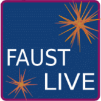

FaustLive
============================
## The swiss knife for [Faust](https://faust.grame.fr) development.
--------------

FaustLive is an advanced self-contained prototyping environment for the Faust programming language with an ultra-short edit-compile-run cycle. Thanks to its fully embedded compilation chain, FaustLive is simple to install and doesn't require any external compiler, development toolchain or SDK to run. 

FaustLive is the ideal tool for fast prototyping. Faust programs can be compiled and run on the fly by simple drag and drop. They can even be edited and recompiled while running, without sound interruption.
It supports also native applications generation using the [Faust online compiler](https://faust.grame.fr/tools/onlinecompiler/).

FaustLive is based on the [Faust](https://faust.grame.fr) library and on [LLVM](http://llvm.org).

## Libraries

Faust libraries are now in a [separated subproject](https://github.com/grame-cncm/faustlibraries). They are synchronized from time to time in the main FaustLive repository using the following commands:

    git submodule update --remote --merge
    make -C Resources                      # regenerates Resources/application.qrc
    make -C Build && make -C Build test    # checks that every bundled library and example compiles
    git add Resources/Libs Resources/application.qrc
    git commit -m "Updating libraries"
    git push

### Limitations and known bugs

 - crashes on Windows when compiling a dsp with input signals, on a machine without input audio device
 - may crash on startup due to incorrect cache. In this case, find the `FaustLive-CurrentSession-2.XX` folder in your home folder, remove it and restart. On Unix like stations (Linux, MacOS), this folder is hidden and located at `$HOME/.FaustLive-CurrentSession-2.XX` 

## Building

### Versionning

- use the *version* script to raise the version number, like `./version 2.5.8`.
- manually raise the `FAUSTLIVE_APP_VERSION` variable in Build/CMakeLists.txt when the session caches (libraries, compiled DSPs) must be reset

### Application building

To build the FaustLive project, go to the `Build` folder and start with the README file.

### Tests

`make -C Build test` builds and runs the test suite (CTest, see the `tests` folder and `AGENTS.md`).

### Continuous integration

The [faustlive workflow](.github/workflows/all.yml) builds the binaries on GitHub Actions: a `.dmg` for macOS
Apple Silicon and one for macOS Intel (macOS 12 or later, ad-hoc signed, not notarized), a `.tar.gz` archive for
Linux x86_64 and aarch64 (glibc 2.28 or later, needs JACK), and the Windows x64 installer.
It runs on tags and from the Actions tab (`workflow_dispatch`), where it can create a draft release.
libfaust is built from the Faust sources with the static LLVM published by the Faust project.

<!--p align="center">
    
  
</p-->

--------------
#### [Grame](http://www.grame.fr) - Centre National de Creation Musicale
